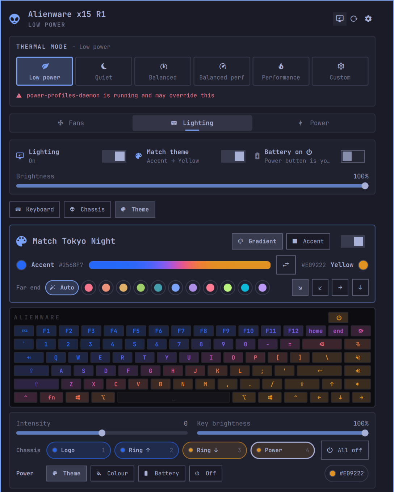
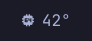
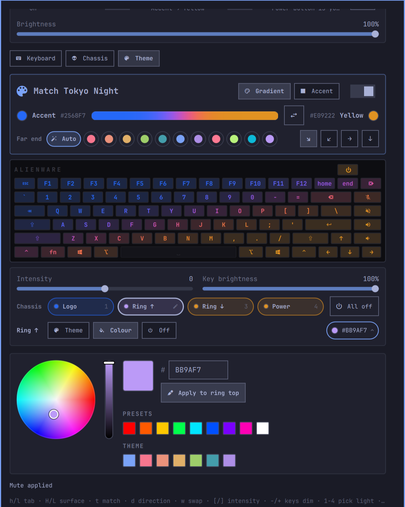
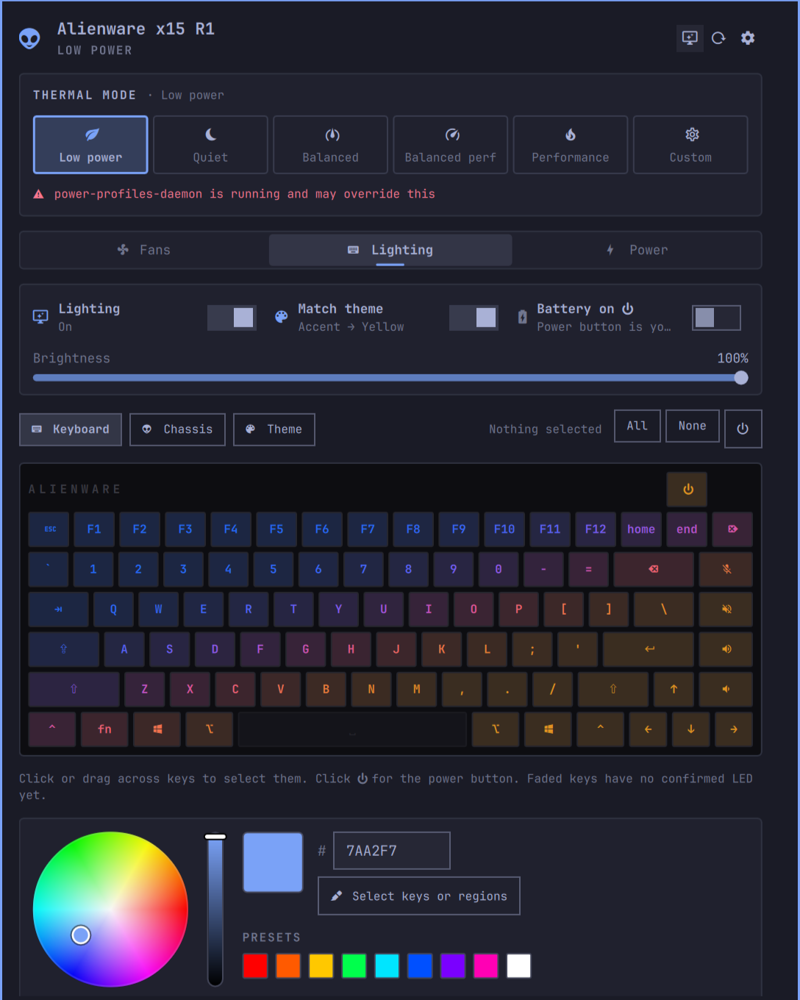
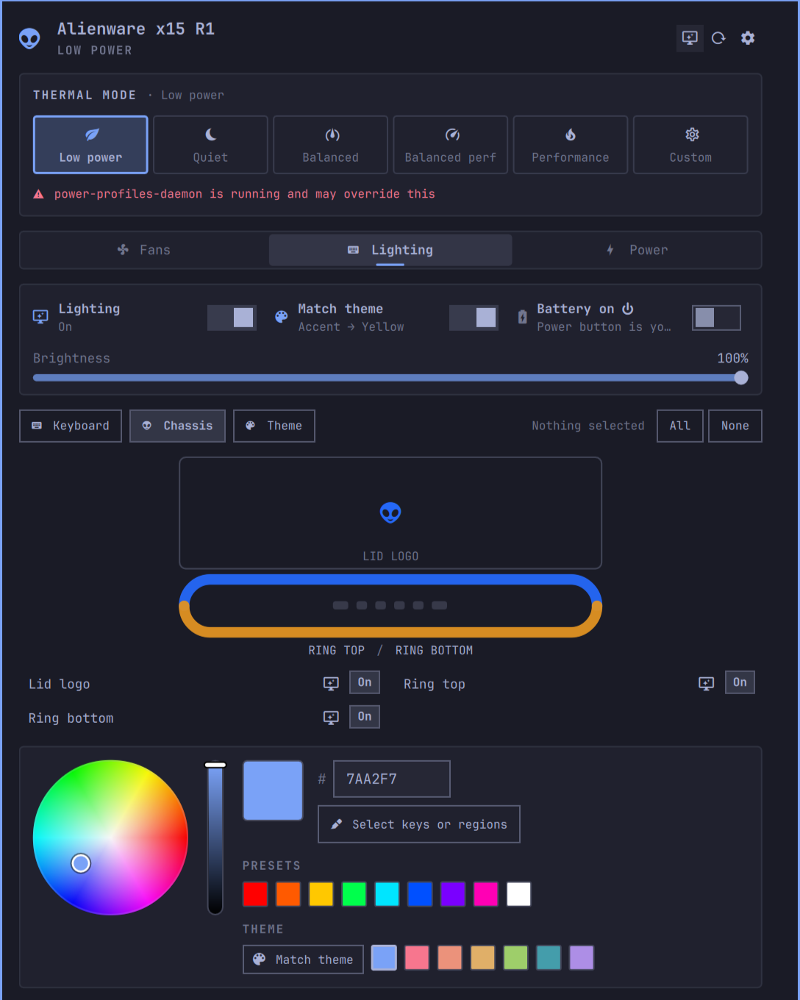
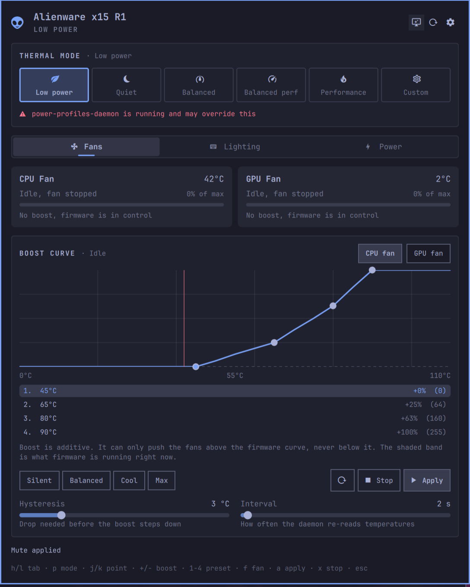
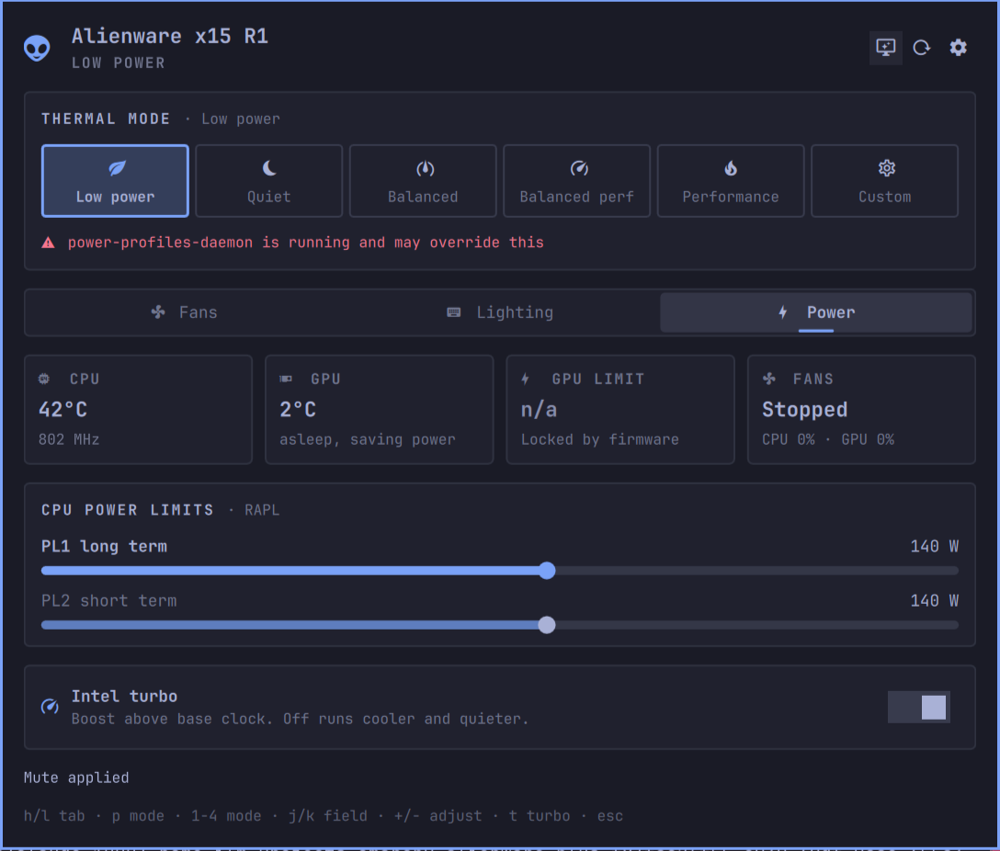

# Alienware FX

**Fans, power and lighting for Alienware x15 laptops, built into the Omarchy bar. Your keyboard and
chassis lights match your Omarchy theme.**

<p align="center">
  
</p>

Alienware FX replaces Alienware Command Center on Omarchy. One click on the bar widget opens a
panel where you can:

- **Change thermal modes** and shape the fan curve
- **Tune CPU power limits** and turbo
- **Paint the lights**: a gradient that follows your theme, your own colours per key, or one colour
  per chassis light

Everything is keyboard friendly, and the panel shows exactly what the hardware is doing.

> [!NOTE]
> This is a fork of [omarchy-alienware](https://github.com/chr0nzz/omarchy-alienware). It adds the
> Theme lighting panel, which uses the colour matching from
> [omarchy-alienfx-plugin](https://github.com/3mrgnc3/omarchy-alienfx-plugin) on top of the same
> hardware helper.

## Highlights

| | |
|---|---|
| 🎨 **Lights that match your theme** | Run `omarchy theme set` and the keyboard and chassis repaint themselves with a smooth gradient between the theme's accent and its most contrasting colour. |
| 💡 **Each chassis light is yours to set** | The lid logo, the two light rings and the power button can each follow the theme, take your own colour, or turn off. The power button can also show the battery state. |
| ⌨️ **Per key colour** | Paint single keys or drag across a row. The panel keeps a live map of the keyboard. |
| 🌀 **Fan curve** | A boost curve on top of the firmware's own, with presets from Silent to Max. |
| ⚡ **Thermal modes and power** | Switch from Low power to Performance, set CPU power limits and turn turbo on or off. |
| 🔇 **Mute keys that tell the truth** | The mic and speaker mute keys glow red while muted. |
| 😴 **Survives suspend** | Lighting and the thermal mode come back after sleep. |

## A quick tour

### In the bar



The widget shows the CPU temperature by default and switches to the urgent colour when the machine runs hot. Click it to
open the panel. In the widget settings you can show other readouts instead: the thermal mode, the GPU
temperature, fan speed or GPU power.

### Lighting → Theme

<p align="center">
  
</p>

Turn on **Match theme** and the lights take the current theme's colours.

**The gradient**
- **Gradient** blends two colours diagonally across the keyboard and chassis. **Accent** paints
  everything in the theme's accent colour.
- Pick the gradient's direction with the arrows (↘ ↙ → ↓). Swap the two ends with ⇄, or choose the
  far end yourself from the theme's colour dots.
- **Intensity** makes the colours softer or more vivid. **Key brightness** dims the keyboard without
  touching the chassis.

**Each chassis light**
- Click **Logo**, **Ring ↑**, **Ring ↓** or **Power** to select it, then choose its mode:
  - **Theme**: the colour from the gradient
  - **Colour**: your own colour from the colour wheel, which updates live while you drag
  - **Battery**: power button only; green while charging, orange on battery, red below 10%
  - **Off**
- The other lights keep matching the theme, including after you change themes.

Your own layout is never lost. Turn Match theme off and your hand-painted colours come back.

### Lighting → Keyboard and Chassis

<p align="center">
  
  
</p>

- **Keyboard:** click or drag across keys, pick a colour, and press **Apply**. A key can also be
  turned off on its own.
- **Chassis:** the same, for the lid logo and the two rings.
- **Painting with theme mode on:** your colours start from the gradient you were looking at, and
  painting switches theme mode off.

### Fans

<p align="center">
  
</p>

**Live readouts**
- Fan speed and temperature for both fans.

**Boost curve**
- Adds speed on top of the firmware's own curve, so the fans can only run faster than firmware wants,
  never slower.
- Drag the points, or start from a preset (**Silent**, **Balanced**, **Cool**, **Max**).
- **Hysteresis** stops the fans from hunting around a threshold.

### Power

<p align="center">
  
</p>

- **Readouts:** CPU and GPU temperatures, GPU power and fan speeds at a glance.
- **CPU power limits:** set the long-term (PL1) and short-term (PL2) limits, when the firmware allows it.
- **Turbo:** turn Intel turbo boost on or off.

The thermal mode buttons at the top of every tab switch between **Low power**, **Quiet**,
**Balanced**, **Balanced perf**, **Performance** and **Custom**.

## Requirements

| Requirement | Details |
|---|---|
| Omarchy | Omarchy 4 with the Omarchy shell |
| Laptop | Alienware x15. It is tested on an x15 R1 and the upstream plugin on an x15 R2. Other models may use different lighting zones and keyboard layouts. |
| Helper | `alienwarectl`, which reaches the hardware. The plugin itself runs without root. |

## Install

1. **Add the plugin:**

   ```sh
   omarchy plugin add https://github.com/ilmcconnell/omarchy-alienware-plus-fx.git --enable
   ```

2. **Install the hardware helper** (a prebuilt binary, so no Go toolchain is needed):

   ```sh
   cd ~/.config/omarchy/plugins/ilm.alienware-fx/packaging/bin
   makepkg -si
   sudo systemctl enable --now alienwarectl.service
   ```

   Or open the panel and press **Install the helper**. It runs the same commands in a terminal, so
   you can read them first. To build the helper from source instead, run `makepkg -si` in
   `packaging/`.

3. **Optional: a keybinding.** Add this to `~/.config/hypr/bindings.lua`:

   ```lua
   o.bind("SUPER SHIFT", "A", "Alienware", "omarchy-shell shell summon ilm.alienware-fx '{}'")
   ```

> [!TIP]
> Already running the original `xyzlab.alienware` plugin or AlienFX? Turn them off so they don't
> fight over the lights:
>
> ```sh
> omarchy plugin disable xyzlab.alienware
> omarchy plugin disable 3mrgnc3.alienfx
> ```

## Keyboard shortcuts

While the panel is open:

| Where | Keys |
|---|---|
| Everywhere | `h`/`l` switch tab · `s` settings · `r` refresh · `esc` close |
| Fans | `p` thermal mode · `j`/`k` choose a point · `+`/`-` boost · `1`-`4` preset · `f` CPU/GPU fan · `a` apply · `x` stop |
| Lighting | `H`/`L` Keyboard/Chassis/Theme · `t` match theme · `o` all lighting on/off · `b` battery on power |
| Keyboard, Chassis | `c` colour · `p` selection on/off · `j`/`k` and `space` choose regions · `i` identify a region |
| Theme | `d` direction · `w` swap ends · `[`/`]` intensity · `-`/`+` key brightness · `1`-`4` pick a light · `p` light mode · `c` light colour · `x` light on/off · `a` all chassis lights |
| Power | `p` thermal mode · `1`-`4` mode · `j`/`k` choose a field · `+`/`-` adjust · `t` turbo |

The panel footer always lists the keys for the view you're on.

## Command line

Everything in the panel can be scripted, for example from a keybinding or a hook:

```sh
omarchy-shell alienwarefx status                    # JSON with fans, temps, profile and lighting
omarchy-shell alienwarefx profile performance       # switch thermal mode
omarchy-shell alienwarefx curve cool                # apply a fan preset (silent, balanced, cool, max)
omarchy-shell alienwarefx turbo off                 # on, off or toggle

omarchy-shell alienwarefx rgb theme ""              # match the theme
omarchy-shell alienwarefx rgb axis lr               # tl-br, tr-bl, lr or tb
omarchy-shell alienwarefx rgb intensity 4           # -10 to 10
omarchy-shell alienwarefx rgb logo FF0040           # one chassis light: theme, custom, off or a colour
omarchy-shell alienwarefx rgb power battery         # the power button can also show the battery
omarchy-shell alienwarefx rgb chassis-off ""        # every chassis light off
omarchy-shell alienwarefx rgb off ""                # all lighting off (on, toggle)

omarchy-shell alienwarefx open                      # show the panel (close hides it)
```

Commands that take no value still need the empty `""` argument.

## Update

```sh
omarchy plugin update ilm.alienware-fx
omarchy restart shell
```

To update the helper too, run `makepkg -si` in `packaging/bin` again and then
`sudo systemctl restart alienwarectl.service`. `alienwarectl version` shows which helper is running.

## Uninstall

Turn the lights off first. Once the helper is gone, nothing is left to turn them off with.

```sh
alienwarectl kbd off
alienwarectl rgb off

sudo systemctl disable --now alienwarectl.service
sudo pacman -Rns omarchy-alienware-bin
omarchy plugin remove ilm.alienware-fx
```

If you built the helper from source, the package is `omarchy-alienware` instead.

Your colours and settings stay in `~/.local/state/omarchy/alienware-fx/` in case you come back.

## Troubleshooting

- **The panel won't close.** It holds the keyboard while it is open. Click outside it, press `esc`,
  or run `omarchy-shell alienwarefx close`.
- **"power-profiles-daemon is running and may override this".** That service can change the thermal
  mode behind your back. Disable it if you want the mode you pick here to stick.
- **The lights didn't change after an update.** Run `omarchy restart shell` so the shell loads the
  new panel.

## How the theme gradient works

The colour picking is a JavaScript port of AlienFX's Python engine. It is checked against values from
the original, so both give the same colours for the same theme. All of it lives in `ThemeFx.js`, with
tests in `tests/themefx.test.js`.

1. **The near end** is the theme's accent colour.
2. **The far end** is the saturated colour in the palette whose hue is furthest from the accent. On a
   single-colour theme, it is the accent's complement instead.
3. **Intensity** sets the saturation of both ends.
4. **Blending** happens in OkLCh, a colour space where equal steps look equal to the eye. An S-curve
   holds each end colour for longer, and colours are clamped to what the LEDs can show.
5. **Each key and light** takes its colour from where it sits on the chosen diagonal.

## More documentation

| | |
|---|---|
| [Hardware](docs/hardware.md) | The two lighting controllers, the region map and the privilege model |
| [Behaviour](docs/behaviour.md) | Suspend and resume, the mute indicator, thermal profiles, G-Mode |
| [CLI](docs/cli.md) | Every `alienwarectl` command |
| [Key map](docs/KEYMAP.txt) | The measured keyboard LED map |
| [Roadmap](docs/roadmap.md) | What works and what is planned |
| [Development](docs/development.md) | Tests and releases |

## Credits and licence

MIT licensed. Built on [omarchy-alienware](https://github.com/chr0nzz/omarchy-alienware) by xyzlab,
which provides the panel, the fan and power controls, and the `alienwarectl` helper. The theme
gradient is ported from [omarchy-alienfx-plugin](https://github.com/3mrgnc3/omarchy-alienfx-plugin)
by 3mrgnc3. Both are MIT licensed.
